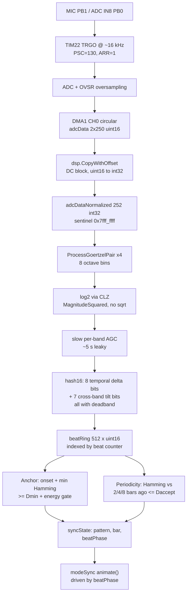

# Party Sync — implementation plan

Multiple earrings, no radio, no shared clock. Each unit listens to the same EDM
track and derives the *same* pattern decisions from it, so they read as one
device to the audience.

The signal model in the brief (log-spaced band energies → sign bits → 15-bit
perceptual hash → two roles: **transition anchor** and **periodicity
confirmation**) is the right model. Everything below is about making it survive
this specific chip.

---

## 1. Success criteria

Define "roughly synchronous" as measurable numbers, or tuning becomes vibes:

| Metric | Target | How measured |
|---|---|---|
| Anchor agreement | Same anchor event within ±40 ms on ≥90% of anchors | two firmware instances replayed over one EDM file with offset + resample |
| Pattern agreement | Same pattern index at same bar ≥85% of the time | same harness |
| Anchor rate | 1 per 8–32 bars (not per beat) | event trace |
| False anchors under crowd noise | < 1 per minute | replay with recorded crowd bed |
| Animation framerate | unchanged vs. `modeVUMeter` today | frame counter on GPIO |

---

## 2. Measured platform budget

Reproduce with:

```
tinygo build -o /tmp/fw.bin -target=./stm32l0x1.json -opt=2 -panic=trap -size=full .
```

| Resource | Total | Used | **Free** |
|---|---|---|---|
| `FLASH_TEXT` (32K − 128 − 1536×3) | 28,288 B | 27,168 B | **1,120 B** |
| `RAM` (8 KB, incl. 2 KB `_stack_size`) | 8,192 B | 7,316 B | **876 B** |

Free RAM and flash are the binding constraints — not CPU time.

### What already exists and is reusable

`datarecv.go` (the receive-patterns-over-sound feature) is not a curiosity, it is
most of the front end:

* ADC channel IN8 (PB0, the mic) triggered by **TIM22 TRGO**, moved by **DMA1 CH0**
  in circular mode — sampling with **zero CPU cost per sample**.
* Runs the core at **MSI Range 6 (~4.19 MHz)**, not the 524 kHz used by
  `enableMic()`.
* ADC hardware oversampling (`OVSR`/`OVSS`), DMA double-buffered by window via
  `adcDataWriteIndex()` reading `DMA.NDTR`.
* `dsp.CopyWithOffset()` — DC removal + uint16→int32 in one pass.
* `dsp.ProcessGoertzelPair()` — hand-written Cortex-M0+ fixed-point Goertzel,
  two bins per call, already linked into the binary.
* `adcData` (800 B) and `adcDataNormalized` (808 B) already exist in `.bss`.

### Instruction availability (verified in codegen, not assumed)

* `bits.LeadingZeros32/16` → **emits a real `clz` instruction**. ARMv6-M has CLZ.
  The brief's "integer log2 via count leading zeros" is free. Do it.
* `bits.OnesCount*` → **no POPCNT in the ARMv6-M/v7-M ISA**; software sequence
  (`math/bits` alone costs 526 B today). Hamming distance is the hot loop of the
  hash comparison, so budget it explicitly: use an explicit 16-entry nibble LUT
  or precomputed `popcount[256]` (256 B flash) rather than paying `math/bits`.
* Cortex-M0+ has a hardware `MUL` but **no hardware divide**. Any `/` in the DSP
  becomes `__aeabi_uidiv` (~40–60 cycles). Replace every division with a shift or
  a reciprocal LUT. This includes `E_b / total`.

---

## 3. Amendments to the brief

These are the parts of the brief that do not survive contact with the hardware or
with the physics of two independent devices. Each is justified above.

### D1 — Sample rate: 16 kHz is affordable, but only at 4.2 MHz, not at 524 kHz

At the current mic-mode clock (MSI Range 3, 524 kHz) the budget is ~524 k
cycles/s *total*, and the cycle-counted bit-bang in `bitbang.h` consumes
~410 cycles per `updateLEDs()` refresh. 16 kHz × a 12-section biquad bank is
roughly 40× over that budget.

At **MSI Range 6 (4.194 MHz)** — already proven in `dataRecv()` — it fits with
~35% CPU headroom (see §6).

**The power objection does not apply.** The µA budget in `microphone.go` matters
in *standby*, where the mic is off. In a sync mode the LEDs are lit: 36 LEDs
draw tens of mA, so ~400 µA of extra core current is a ~1% battery impact. The
mic modes already run at Range 3 for framerate reasons. **Raise the clock during
sync mode and stop optimising it away.**

Verified constraint: `PWR.CR.VOS_V1_2` (used by `setClockSpeed`) caps the core at
8 MHz, so **Range 6 (4.194 MHz) is the sweet spot**; Range 7 (8.39 MHz) would
require raising VOS. Do not go there.

The bit-bang needs no rework: the 1/2/4/8/16-cycle plane durations become 8×
shorter but their *ratios* are unchanged, so average brightness is unchanged. The
only exposure is whether the shortest plane (1 cycle = 238 ns) still produces
visible light at the higher clock. **Measure in M0**, and if it dims, insert a
fixed pad cycle count in the 1-cycle phase.

### D2 — Use N = 250, not 256

`ProcessGoertzelPair` requires the sample count to be **a multiple of 10** (plus
two sentinel samples, the last holding `0x7fff_ffff`). 256 is not.

N = 250 at fs ≈ 16 kHz is better than 256 anyway:

* hop = 250 / 15.997 kHz = **15.6 ms** (brief wants 16 ms);
* bin spacing = fs/N = **64 Hz**;
* every octave lands on an *exact* DFT bin — 128, 256, 512, 1024, 2048, 4096,
  8192 Hz are 2, 4, 8, 16, 32, 64, 128 × 64. **Zero rounding error in
  `GoertzelFixedConsts.Init`, exact octave spacing, for free.**

Achievable fs: `TIM22` at 4.194304 MHz with `ARR=1`, `PSC=130` gives
fs = 4.194304e6 / (2 × 131) = **15,996.6 Hz** (−0.02% vs. 16 kHz). Exact 16 kHz
needs a 16 MHz timer clock, which breaks `VOS_V1_2` and the bit-bang. 0.02% is
irrelevant; take it. (The comments in `datarecv.go` list only Range-6-friendly
rates for this reason.)

### D3 — Index the hash ring by *musical beat*, not by frame — this is the make-or-break change

The brief says "kept in a small ring buffer (last 2–8 s)" and "matches an entry
2, 4 or 8 bars ago". **There is no shared clock between two earrings.** The MSI
oscillator is factory-trimmed to roughly ±1% at 25 °C and drifts further with
voltage and temperature; two units plausibly differ by 2–4%. Indexed by wall
clock:

| Drift | After 2 s | After 8 s |
|---|---|---|
| 1% | 20 ms | 80 ms |
| 3% | 60 ms | **240 ms** |

At 128 BPM a beat is 469 ms, so 8 s of drift is half a beat — the periodicity
lookup silently compares the wrong musical positions and the feature degrades to
noise. Worse, per-frame normalization and the "3 frames ago" delta then sample
different parts of the waveform on each device.

Fix: **push to the ring once per detected beat, and index by beat counter.**
Both earrings then write to the same slot because they agree on the *music*, not
because they agree on *time*. Drift becomes self-correcting: every anchor resets
the phase on every device simultaneously.

Consequence: the ring needs no absolute timestamps at all. `beatRing[beat & 511]`.
At 128 BPM, 512 beats ≈ 4 minutes of history for more than the requested 8 s, and
the whole structure is 1 KB.

### D4 — Hash is 15 bits in a `uint16`, and every `sign()` needs a deadband

Packing to 15 bits (not 32) halves the ring and is what makes 512 entries fit.

The bigger issue is robustness. `sign(E_b(t) − E_b(t−3))` is maximally sensitive
exactly when the difference is near zero — which is most of the time — so two
earrings will differ in ~half the bits whenever the music is steady. Add a
**relative deadband** to every comparison:

```
// bit set only if the change exceeds ε of the reference energy
func deltaBit(now, prev uint32) bool { return now > prev + (prev >> 3) } // ε = 1/8
```

This single change dominates every other tuning knob for cross-device agreement.
Tune ε in M5.

### D5 — 8 bands, not 12; Goertzel comb first, cascaded biquads as the upgrade

The brief's "8–12 cascaded biquads (log/mel spaced)" — read as a *passband
cascaded* bank (one section per band, each tapped) — costs ~1 biquad per band per
sample. With 8 bands and shift-add coefficients that's ~50 cycles/sample ≈
800 k cycles/s ≈ 19% of a 4.19 MHz core. Affordable.

But **flash is the binding constraint (1,120 B free)**, and a from-scratch
fixed-point biquad bank plus coefficient tables will not fit in that. So:

* **Ship first: a Goertzel octave comb**, reusing `dsp.ProcessGoertzelPair`,
  already linked. Incremental flash ≈ the calling code and 4 `uint32` constant
  pairs. Cheaper to write, cheaper to run (~5 cycles/bin/sample), and with N=250
  it gives exact octaves (§D2).
* **Upgrade later: the cascaded biquad bank**, only if flash is reclaimed (§7) or
  if the octave comb proves too narrow-band. Caveat: a Goertzel bin is a matched
  filter of fixed *absolute* width (64 Hz), so it samples a sliver of each high
  octave rather than measuring critical-band energy. Fine for hashing (arguably
  better — more distinctive); if broadband HF energy matters, sum 2–3 adjacent
  bins for the top bands.
* Cascaded banks also have rising Q and falling gain with section index, so
  per-band normalization (§Stage 3) is mandatory either way.

### D6 — Normalize twice: per-frame (brief) *and* slow per-band

Per-frame normalization removes overall level, so earrings at different distances
from the PA agree. It does **not** remove *spectral tilt*, which differs per unit
from hand shadowing, ear position, and individual MEMS sensitivity. Cross-band
tilt bits `sign(E_b − E_{b+1})` are exactly the bits most damaged by tilt.

Add a slow leaky per-band gain normalizer (~5 s time constant) so tilt bits
compare each band against its own recent average rather than against its
neighbour raw. Keep the brief's per-frame normalization as well.

### D7 — Pattern selection must be a pure function; no RNG

`math.go` provides `rand()`/`xorshift32` and several modes use it. In sync mode
any local randomness guarantees divergence. Every pattern decision must be a
deterministic function of `(matched lag, bar index, hash)`. Add a lint rule for
M4: no `rand()` reachable from the sync decision path.

---

## 4. Architecture



---

## 5. Stages

### Stage 0 — Platform measurement (do not skip)

Everything downstream depends on numbers nobody has measured. Add temporary
instrumentation, then delete it.

1. **Actual DMA+LED coexistence.** Run the `dataRecv()` capture config
   continuously *with LEDs animating* at Range 6. Confirm:
   * no DMA overrun (`adcDataWriteIndex()` monotonic, no `println("overflow!")`);
   * LED brightness/duty unchanged vs. DMA off — scope one anode pin, compare
     duty with DMA enabled and disabled.
     *Expected:* a DMA write to SRAM can stall the `ldr` from `bitplanes` by 1–2
     cycles, which *lengthens one phase and shortens the next by the same amount*.
     Average duty over the 31-cycle period should be unchanged. Verify, don't
     trust.
   * if duty shifts measurably, drop `OVSR` to `Mul2`/`Mul4` (proportionally less
     DMA traffic) before considering anything more invasive.
2. **LED-current contamination of the mic.** Capture in a silent room with LEDs
   off, then at full white. Look for spectral lines at the refresh rate and its
   harmonics. `main.go` deliberately interleaves ADC reads between LED updates so
   "the LED power won't interfere too much with the microphone" — **DMA capture
   gives that up.** Note that in the new architecture the refresh cadence becomes
   *deterministic* (fixed loop), so any lines land on stable, notchable
   frequencies rather than wandering with animation cost. If lines are strong:
   reduce sync-mode brightness, or notch those bins out of the band set.
3. **Shortest-pulse visibility at Range 6** (§D1).
4. **Stack high-water mark.** Fill the 2 KB stack with a `0xA5` canary, run the
   heaviest mode for a minute, measure actual usage. Determines how much RAM is
   genuinely reclaimable (§7).
5. **MSI drift between two units.** Toggle a GPIO every 2^16 TIM22 updates on two
   earrings, measure relative rate over 60 s. Gives the real drift number instead
   of a datasheet guess.

**Exit:** overrun-free capture with LEDs animating; a drift number; a RAM number.

### Stage 1 — `syncdsp`: pure-Go package, host-tested first

Create `syncdsp/` with **no `baremetal` build tag** so it compiles and tests under
plain `go test`. This is where the real design work happens and it must not be
device-bound.

Use **explicit-width types everywhere** (`int32`/`uint16`/`uint32`), never bare
`int` — TinyGo's `int` is 32-bit on ARM but 64-bit on the host, and a silent
parity bug here is miserable to find on a 36-LED output device.

Files:

* `syncdsp/bands.go` — band frequency set, `GoertzelFixedConsts` precomputation,
  `func Bands(samples []int32, out *[8]uint32)`.
* `syncdsp/hash.go` — `func Hash(energy *[8]uint32, prev *[8]uint32) uint16`.
* `syncdsp/ring.go` — beat-indexed ring, min-Hamming and lag lookup.
* `syncdsp/beat.go` — onset detection, tempo histogram, bar phase.
* `syncdsp/state.go` — the decision machine, pure and deterministic.

Cross-band tilt needs a **magnitude**, not just log2: `sign(E_b − E_{b+1})` on
`log2` values is equivalent to comparing the raw magnitudes, so keeping log2
throughout is both cheaper and safe. Compute log2 once:

```go
// log2 of a positive value, 8 fractional bits, via hardware CLZ.
// Cost: ~5 cycles. No float, no divide.
func log2e(v uint32) uint32 {
	if v == 0 {
		return 0
	}
	n := 32 - uint32(bits.LeadingZeros32(v)) // position of MSB, 1..32
	frac := (v << (32 - uint(n))) >> 24      // 8 fraction bits
	return (n-1)<<8 | frac
}
```

Use `MagnitudeSquared()`, not `Magnitude()` — `log2(mag²) = 2·log2(mag)`, and the
factor of 2 cancels in every normalized difference, so the `ISqrt32` is wasted
work. (Note `MagnitudeSquared` itself uses `int64` internally → software 64-bit
multiply on M0+. Only 8 calls/frame, acceptable.)

### Stage 2 — Capture re-plumbed for continuous operation

Refactor the capture half of `dataRecv()` out of `datarecv.go` into
`capture.go` so `dataRecv()` and sync mode share one implementation. Currently
`dataRecv()` hard-codes `disableLEDs()`, `sampleRate = 10000`, and `windowSize =
200`, all of which must become parameterised.

```
capture.go
  startCapture(fs int)          // TIM22 + ADC + DMA1 CH0 + OVSR, LEDs stay on
  stopCapture()
  nextWindow() []int32          // blocks until a 250-sample window is ready
```

`nextWindow()` reuses the existing double-buffer trick: watch
`adcDataWriteIndex()` (= `len(adcData) − NDTR`) cross the window boundary, then
`dsp.CopyWithOffset` into `adcDataNormalized` and stamp the `0x7fff_ffff`
sentinel at index 250. Keep `adcDelaySamples()` — it exists for a reason and the
"stuck DMA" comment means there is a real hardware quirk behind it.

**Critical:** the existing `windowSize` is derived from `sampleRate` at compile
time. Making `fs` runtime-variable would introduce float division in `Init`.
Instead keep both **`const`** (`sampleRateSync = 15997`, `windowSync = 250`) and
build two small constant sets, or gate on a build tag. Do not make it dynamic.

### Stage 3 — Energy, normalization

Per 15.6 ms frame, per band `b`:

1. `mag2[b] = MagnitudeSquared()` (no sqrt).
2. `e[b] = log2e(mag2[b])` — fixed point, 8 fractional bits.
3. **Per-frame normalization** (brief): `total = Σ e[b]`; `en[b] = e[b] − (total >> 3)`.
   Subtraction, not division — this is the brief's "or work with differences",
   and log-domain makes division free.
4. **Slow per-band AGC** (D6): `agc[b] += (e[b] − agc[b]) >> 6` at 64 frames
   (~1 s) or `>> 8` (~4 s); subtract before the tilt computation.
5. Keep a 3-frame-deep energy history: `ehist[3][8]` = 96 B.

### Stage 4 — Hash

*As built (30 bits in a `uint32`, all three fields gain-invariant by
construction — every comparison is between two quantities that share the
device's unknown gain, so no AGC is needed and none is used):*

```
temporal[b] (8 bits):  smoothed[b] - prevPushed[b] > TemporalDeadband   // rising since last beat
shape[b]    (14 bits): 2-bit code of smoothed[b] - fittedLine[b]        // least-squares line over the 8 bands
hot[b]      (8 bits):  smoothed[b] >= max(smoothed) - HotFloorQ8        // within 18 dB of the loudest
```

The fitted line (slope `× 49939 >> 16`, denominator 336 — all integer) replaces
the brief's cross-band tilt bits: a tilt `sign(E_b − E_{b+1})` compares adjacent
bands, which in EDM (a smooth ~ −3 dB/oct spectrum plus a kick) flips on
sub-dB noise. Deviation from the *global* line is stable where adjacent-pair
comparison is not, and it is what makes the hash survive a per-device spectral
tilt (+4 dB HF measured).

The brief's "change mask" turned out to be unnecessary: with deadbands inside
every field (rather than around a raw sign) there is no noise-only bit flip to
mask, and the mask would itself be device-specific.

Measured on the synth stimulus: steady-state cross-device distance p95 ≤ 1-2
bits, adjacent-section identity distance ≥ 6 bits.

### Stage 5 — Beat tracker

*As first built* — Dixon/McKinley-style onset-interval histogram plus a phase
PLL that nudged the phase toward each onset. Both were replaced: onset
intervals carry no tempo (see `tempoScan`), and bass onsets are as often a bass
note or a fill as a kick, so the PLL wandered and two earrings rarely agreed on
where the beat was.

*As built now:*

* **Period** — `tempoScan`: autocorrelation of the loudness envelope over
  4 s every 2 s, evidence accumulated per lag; the period is the peak lag,
  refined to Q8 frames by the parabola through it and its neighbours
  (143 BPM is 26.85 frames).
* **Phase** — a beat comb in `Tick`: the positive two-frame flux of the bottom
  band (the kick), leaky-averaged (8 beats) into one bin per frame of the beat
  cycle; the beat fires on the bin with the most flux, with a half-period
  refractory. `beat` is a *monotonic* counter — nothing ever resets it (a reset
  shifts one device's ring against the others').
* Measured with `beat_eval_test.go` against a kick reference (librosa's DP
  tracker on the mel bands below 200 Hz; librosa's full-band tracker sits on
  the off-beat hats half the time on this music) over three 10-minute
  stretches of an EDM set and four device-pair scenarios: beats within 70 ms
  of a kick 31% → 56%, the two earrings' beats within 32 ms of each other
  39% → 73%. Pattern agreement unchanged.

Budget ~100 cycles/frame plus the scan, ~220 B RAM.

### Stage 6 — The two roles

*As built. Two properties govern both roles, both learned the hard way in the
agreement harness:*

*Everything that decides is evaluated on the settled, smoothed spectrum. The
ring only ever receives hashes whose *identity* fields (shape+hot) have held
for `AnchorSettleFrames`; a transition's transient never enters the ring. And
`noveltyMin` skips the ring's leading run of near-matches (entries pushed since
the hash settled) — otherwise the entries the current section itself wrote
score distance 0 and novelty can never be seen.*

**Anchor** — per frame, not on beat boundaries. A first implementation gated
the anchor on `beat && onsetAge <= 2`; measurement showed this fires on one
device and not the other at the *same* musical transition, because which frame
a PLL emits a beat on is device-specific. Onsets and hash-settling, by
contrast, are functions of the audio alone:

```
stableFrames >= AnchorSettleFrames &&      // hash identity has settled
onsetAge <= AnchorOnsetMax &&              // the brief's "strong onset"
total > level + (1<<7) &&                  // the brief's "high energy" (log units, so additive)
noveltyMin(h) >= DMin &&                   // far from the ring (window: last 24 beats)
hashDist(h, lastAnchorHash) >= AnchorRepeatDist &&   // identity only; once per section
frame - lastAnchorFrame >= AnchorRefractoryFrames
→ pattern = patternFor(current spectrum); refractory reset
```

Note `energyGate` is `total > level + 128`, not `total > 2*median`: `total` is
a *sum of logs*, so a multiplicative gate is unreachable; in log units +128
(= 0.5 log2 spread over the band sum) is the natural "clearly above average".

An anchor does **not** reset the beat counter or bar (an earlier version did,
and that permanently misaligned two devices' ring indices — after which "4 bars
ago" is different music on each earring). It only snaps the pattern.

**Periodicity** — at each settled beat push:

```
for lagBars in [2, 4, 8]:
    for lag in lagBars*4 ± LagTolerance:      // device beat counts drift ±1-2 beats
        if hashDist(h, ring[beat - lag]) <= DAccept: returned = true
if (returned || barBoundary) && refractory ok:
    pattern = patternFor(current spectrum)    // pure function — no rand()
```

The result is deliberately a yes/no, not *which* lag matched: choosing between
candidate lags is a knife-edge measurement (devices pick different lags at the
same transition), and the brief only requires that a confirmation switches the
pattern. `patternFor` = the band with the largest fitted-line deviation, with
hysteresis (`PatternMargin`) against close challenges — deterministic (D7),
identical on every device given the same spectrum.

### Stage 7 — Drive the animation

* Add `modeSync` to the mode enum in `animation.go` — insert **before**
  `modeLast` to keep `modeVariants` slicing valid, and add it to
  `animationNeedsMic()` and `variantsPerMode`.
* Animations must read **`beatPhase` / `bar`**, not the raw `frame` counter.
  Frame-count-driven motion drifts between devices for the same reason the ring
  buffer would. This is the detail that turns "same decisions" into "looks
  locked".
* Reuse existing animations parameterised by musical position:
  `twoTracers` / `noise` / `sparkle` are the natural fits.
* `initMode(modeSync)` → `startCapture()`; leaving the mode → `stopCapture()`.
* Restore `defaultMSIRANGE` and `PPRE2` on exit; `disableMic()` currently owns
  that teardown and assumes Range 3, so it needs a Range-6 path.

---

## 6. CPU budget per 15.6 ms frame @ 4.194 MHz

| Item | Cycles | Notes |
|---|---|---|
| Total available | 65,400 | |
| LED refresh (16 × `updateLEDs`) | 6,560 | ≥1 kHz group refresh |
| `setLEDs` × 16 | 1,760 | |
| `animate()` × 48 | ~14,400 | Perlin-cost case; cheaper modes less |
| Goertzel: 8 bins × 250 samples | ~10,000 | ~5 c/bin/sample |
| `CopyWithOffset` + DC | ~1,300 | |
| log2 + AGC + normalize ×8 | ~400 | CLZ is hardware |
| Hash bit packing | ~150 | |
| Anchor: ~170 popcounts | ~1,400 | nibble-LUT popcount |
| Beat PLL + histogram | ~300 | per onset |
| DMA bus steal | ~3,000 | |
| **Subtotal** | **~29,300** | **45% of core** |
| **Headroom** | **~36,100** | **55%** |

Comfortable. A later cascaded-biquad bank adds ~12,000 and still fits.

---

## 7. RAM and flash reclamation

**RAM** — target ~3.0 KB for `adcData` (1,000 B, N=250 ×2 windows) +
`adcDataNormalized` (1,008 B) + `beatRing` (1,024 B for 512 × uint16). Only 876 B
is free, so reclaim:

| Lever | Frees | Cost |
|---|---|---|
| `animationBufSize` slack 1024 → 512 | 512 B | less fountain-code headroom |
| `_stack_size` 2048 → measured+margin | 0–1,024 B | needs Stage 0.4 data |
| Overlay sync buffers on `animationBuf` via one `//go:align 4` scratch array | up to 2,556 B | unsafe casts; only valid because `modeSync` never uses custom patterns |
| Drop the 3rd custom slot | 1,536 B RAM-equivalent + 1,536 B flash | loses a user pattern slot |

The overlay is the big win and is legitimate: `animationBuf` is live only for
`modeCustom0..2` and during `dataRecv()`, never in `modeSync`. Implement as one
shared array plus explicit casts, with a comment stating the invariant, and
assert the mode at `startCapture()`.

**Flash** — 1,120 B free is the real risk. Order of operations:

1. Reuse `ProcessGoertzelPair` / `CopyWithOffset` (already linked) → near-zero
   incremental cost for the DSP core. **This is the main reason for D5.**
2. Keep `syncdsp` float-free and divide-free (`__aeabi_uidivmod` is ~200 B).
3. Build the band constants at *compile* time from exact integers (k = 2,4,8,…,128
   per §D2) so no `Init`/`math.Cos` path is pulled into the binary — note
   `GoertzelFixedConsts.Init` takes `float32` and drags in soft-float. Generate a
   `const` table instead.
4. Explicit 256-B popcount LUT rather than `bits.OnesCount16` if the LUT is
   smaller than LLVM's lowering — measure both.
5. If still short: `-opt=z` on `syncdsp`, reduce bands 8 → 6, or drop
   `modeCustom2` for 1,536 B.

Track flash after every stage with `-size=short`. Treat > 900 B free as a hard
gate before merging M3.

---

## 8. Validation harness

Device iteration here is slow (flash, no scope at a party). Do the design work
against recordings.

```
syncdsp/testdata/
  track-a_16k.wav      # 3 min EDM, kick grid obvious
  track-a_crowd.wav    # same track + recorded crowd bed
  track-a_tilted.wav   # ±6 dB HF shelf  (hand shadowing)
  track-a_quiet.wav    # −12 dB          (distance from PA)
```

**Agreement test** — the actual definition of "roughly synchronous":

Run `syncdsp` twice over the same file with independent distortions, then compare
decision streams:

1. **Sample offset** — random 0–250 sample start.
2. **Clock drift** — resample instance B by +0.5% and −0.5% (models D3; this test
   fails on a wall-clock-indexed design and passes on a beat-indexed one — it is
   the single most valuable test in the suite).
3. **Spectral tilt** — instance B HF-shelved ±6 dB (tests D6).
4. **Gain** — instance B −12 dB (tests per-frame normalization).

Report the §1 numbers. Add `go test -fuzz` on the hash/energy path for
overflow — `MagnitudeSquared` is a 32-bit result of 64-bit intermediates and will
wrap on loud low-frequency frames. Wrapping is silent and catastrophic here.

**Parity test** — dump 200 real capture windows from the device (over the existing
`datatrans` link, or a debug GPIO/bit-banged UART) and assert the host and device
produce **bit-identical** hashes. This catches the `int`-width and fixed-point
slip differences that would otherwise show up as "they don't sync and I don't
know why".

**On-device event trace** — `println` isn't wired on this board. Toggle a spare
GPIO on anchor / pattern-change and read it with a logic analyzer, or borrow the
LED pins used as indicators in `dataRecv()`.

---

## 9. Milestones

| | Deliverable | Exit criterion |
|---|---|---|
| **M0** | Stage 0 measurements | overrun-free capture with LEDs animating; drift + stack numbers |
| **M1** | `syncdsp` + golden-file tests | hashes stable under gain/tilt on host; agreement harness reports numbers |
| **M2** | Device capture + bit-exact parity | device hashes == host hashes on a captured vector |
| **M3** | `modeSync`, **anchors only** (no periodicity) | **first visible sync**: two earrings both reset at the drop |
| **M4** | Beat PLL + bar/beat ring + periodicity switching | agreement harness ≥ targets |
| **M5** | Tuning: ε, `Dmin`, `Daccept`, refractory, AGC τ, energy gate | at a real party, or a phone PA + recorded set |
| **M6** | Soak + power | 2 units, 10 min, no divergence; battery impact measured |

**M3 is the milestone that matters.** Anchors alone — everyone resets on the drop
— deliver most of the perceived effect, need no shared clock, no tempo tracker,
and no ring lookup. Ship that, then earn the periodicity feature.

---

## 10. Risks and fallbacks

| Risk | Detection | Fallback |
|---|---|---|
| DMA vs. bit-bang SRAM contention corrupts LED duty | scope, M0 | `OVSR`→`Mul2`; capture in 15.6 ms bursts between refreshes; drop fs to 8 kHz |
| LED refresh lines contaminate the hash | M0.2 spectral check | stable cadence → notch those bins; pick band set avoiding them; lower sync-mode brightness |
| Flash overflow (>1,120 B) | `-size=short` every stage | §7 ladder; drop `modeCustom2` |
| RAM overflow | linker error | overlay on `animationBuf`; `beatRing` 512→256 (4 bars at 128 BPM still ample) |
| Agreement too low to work | M1 harness | **drop to 8 bits (temporal only)** — halves the error surface and roughly squares agreement probability; this is the escape hatch, keep it as a build flag |
| Beat PLL won't lock on breakdowns/drops | M4 traces | anchor resets the PLL; widen pull-in range; fall back to fixed 128 BPM |
| `VOS_V1_2` / 8 MHz cap | M0 datasheet + run test | stay at Range 6 (already the plan) |
| Shortest bit-plane invisible at 4.2 MHz | M0.3 | pad the 1-cycle phase; or brightness-compensate per plane |
| `MagnitudeSquared` overflow on bass-heavy frames | `-fuzz` | pre-shift samples down 1 bit; or clamp |

---

## 11. Tunables (single place, all `const` in `syncdsp/consts.go`)

*As built. These are the live values; the plan-time guesses in the first
revision of this file (dMin=6, deltaFrames=3, agcShift, 15-bit hash, 512-slot
ring) were superseded by measurement — see Stages 4-6.*

*The shipped build also dropped the third custom pattern slot
(`modeCustom2`, `stm32l031x6.ld`: `FLASH_TEXT = 32K - 128 - 1536*2`) and
reached **29,516 B flash / 7,180 B RAM** of a 29,824 / 8,192 budget (29,548 /
7,176 with the §11.1 changes, both custom slots kept). The size
was paid for with: `//go:noinline` boundaries around every DSP function
(`-opt=2` otherwise inlines and unrolls the whole call graph into one blob),
const-string color tables instead of `var` arrays (no initializer code, no
`.data` image, no RAM — see `flags.go`/`noisePalettes.go`, regenerate with
`gen_flags.py`/`gen_palettes.py`), a minimal own flash driver (`flash.go`)
instead of `device/stm32/flash` (note: `flashWrite` reinterprets its buffer as
words, so callers must keep it 4-byte aligned), `mulQ16` instead of 64-bit
multiply, and `adcDataNormalized` overlaid on the unused tail of
`animationBuf`. Overlaying `syncPipe` there too was tried and **rejected**:
stores through the `unsafe.Pointer` cast alias the DMA buffer and cost +592 B
of lost register allocation.*

```go
const (
    SampleRate = 15997   // nominal Hz (bank coefficients); the device now
                         // runs TIM22 PSC=499 @ 16 MHz HSI16 = exactly 16000
    Window     = 250     // samples per analysis frame (15.6 ms)

    NBands     = 8       // one-pole ladder: 7 corners + the lowpass remainder
    HashBits   = 30      // 8 temporal + 14 shape + 8 hot, in a uint32

    TemporalDeadband = 128        // Q8 log2 = 3 dB rise to set a temporal bit
    ShapeLoQ8        = 128        // shape code 1: +3 dB above the fitted line
    ShapeHiQ8        = 512        // shape code 2: +12 dB
    HotFloorQ8       = 3 << 8     // hot band: within 18 dB of the loudest
    RelFloorQ8       = 10 << 8    // noise pin, 30 dB below max, applied post-smoothing
    SmoothShift      = 5          // spectrum time constant: 32 frames ≈ 0.5 s

    RingSize        = 64   // beats; power of two for & masking          (D3)
    NoveltyWindow   = 24   // beats ≈ 6 s the anchor looks back
    DMin            = 2    // >= ring distance => novel
    DAccept         = 3    // <= ring distance => periodic match
    LagTolerance    = 2    // beats; device beat counts drift apart
    LagBars1/2/3    = 2, 4, 8

    AnchorSettleFrames    = 8   // hash identity stable before it is trusted
    AnchorOnsetMax        = 20  // ~220 ms: onset recency for the anchor
    AnchorRefractoryFrames = 64 // ~1 s
    AnchorRepeatDist      = 4   // identity bits it must move to anchor again

    PatternRefractoryBeats = 4
    PatternMargin          = 32 << 8  // hysteresis for a band to take the pattern
    NumPatterns            = 7        // = NBands-1 (one per winnable band)

    WarmupFrames        = 64
    BeatMinPeriod       = 18  // frames ≈ 213 BPM (retuned, see 11.1)
    BeatMaxPeriod       = 49  // frames ≈ 49 BPM
    BeatRefractoryFrames = 15 // ~234 ms between onsets (retuned, see 11.1)
    LockCount           = 12  // onset support required for lock
    SilenceDiv          = 64  // linear peak-hold leak for silence detection
    LoudDecay           = 7
    LoudMinFloor        = 1 << 12
)
```

### 11.1 True 16 kHz and the frame-rate retune

The first release never actually sampled at 16 kHz, so everything before this
subsection describes a machine running 1.82x slower than its constants
assume. The ADC runs 32× oversampled (~461 ADC cycles ≈ 110 µs per sample)
but the MSI Range 6 core clock only triggers it every 62.5 µs, so every other
trigger was dropped: the real `fs` was **8.8 kSPS**, frames lasted 28.4 ms,
and the whole pipeline ran at ~35 fps. (Sync still worked — every device
made the same mistake, and the agreement is relative — but frame-unit
constants tuned by reasoning about 64 fps were quietly mis-calibrated.)

Sync mode now runs from **HSI16 at exactly 16 MHz** — voltage range 1 (1.8 V
regulator scale), one flash wait state, ADCPRE = AHB/2 (ADCCLK 8 MHz; /1
exceeds the 14 MHz ADC limit, /4 is too slow to catch the triggers), TIM22
PSC=499/ARR=1 → fs = 16 MHz/(2·500) = 16,000 Hz exactly, 64 fps for real.
This costs regulator current: accepted for now (the sync demo runs from the
bench supply; a battery revisit may cap sync-mode run time or drop back to
MSI Range 8 @ 8.4 MHz, which needs its own retune).

At 64 fps the frame-unit constants stop being equivalent (they were
calibrated against the accidental 35 fps):

```go
BeatMinPeriod        = 18     // was 10 — at 64 fps 10 frames is 426 BPM, so
                              // hat-rate intervals voted and won: confident
                              // double-time locks (274–349 "BPM") on 143 BPM
                              // music
BeatRefractoryFrames = 15     // was 8 — 8 frames let open hats 13–14 frames
                              // after a kick pass as separate onsets
LockCount            = 12     // unchanged; weights are relative to it
```

Two pipeline changes came with it, both measured against ground truth:

* **Flux is a 2-frame delta** (`total - prevTotal2`). A kick attack rises over
  2–3 frames at 64 fps; a 1-frame delta crosses threshold on whichever frame
  it happens to cross, so consecutive kick intervals scattered 18–36 frames
  for one constant tempo and the histogram never reached `LockCount`. At the
  old 8.8 kSPS one frame already spanned the attack — the old behavior was
  the 2-frame window by accident.
* **Vote tolerance + half-rate decay.** Each onset votes `interval ±1/±2`
  (weights 4/2/1) to bridge the residual scatter, and the histogram decays
  every *other* onset: the evidence budget per second is set by the onset
  rate (~2.5/s), not the frame rate, so per-onset decay halved the effective
  horizon when the frame rate doubled.

Ground-truth BPM for tuning came from the host, not the ear: scipy butter
LP 200 Hz → 100 Hz envelope → flux → autocorrelation peak in 100–180 BPM.
The test EDM segments at 45/120/600 s = 142.9 BPM, at 300 s = 153.8 BPM. The
pipeline is pure integer Go, so `tools/hostbeat` and
`syncdsp/replay_debug_test.go` (`HOSTBEAT=/tmp/seg.wav go test -v -run
TestReplayWav ./syncdsp/`) replay real audio through the exact firmware code
— tuning loops run there at seconds per iteration. On the device,
`tools/telem.py` (against the `debug-beat-tracking` branch, which carries the
RAM telemetry ring this build omits) reads the live pipeline state over SWD
without halting the CPU; `tools/exp.sh` sweeps one const through
test+build+flash.

Verified before merging: host replay locks at period 25 on the 143 BPM
segment; the same pipeline on the device, through bench speakers, locked
756/756 frames at 62.9 fps with the exact onset count of the host replay —
confirming the host/device bit-identity that makes the host loop valid.
