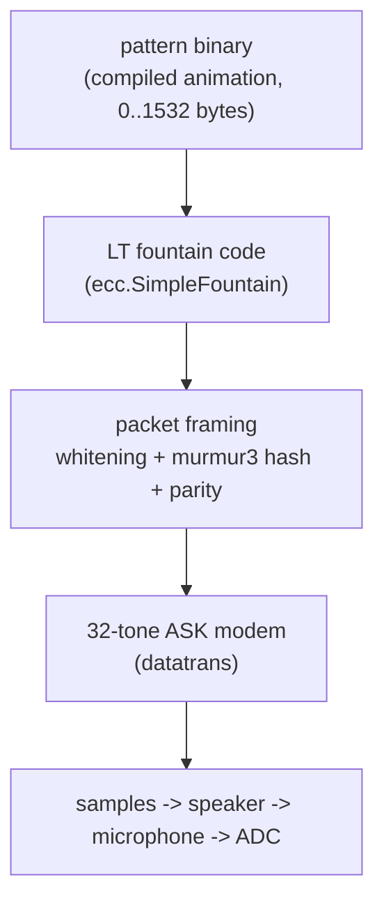

# Scream: how the data is encoded in the audio

This document describes, byte by byte and sample by sample, what the audio coming out
of <https://aykevl.nl/apps/led-editor/> actually contains, and what the earring does
with it.

It is written to be complete enough to implement an independent encoder or decoder
from scratch, and to be the reference when changing the protocol.

Everything here was verified against the real implementations, not guessed:

* encoder: `codeberg.org/maaike328p/datatrans` (Go, also compiled to wasm for the browser)
* decoder: the same package, used by `earring-ring-rgb36v2/datarecv.go` on the STM32L031
* payload: `codeberg.org/maaike328p/led-editor/pattern` + `language/link.ld` in led-editor

Two tools in `tools/` reproduce the results in this document:

| tool | what it does |
|---|---|
| `tools/decode.py` | independent numpy decoder: WAV file → message bytes |
| `tools/screamcheck` | real Go encoder/decoder: makes WAVs, measures receive time |

```console
$ cd scream/tools/screamcheck && GOFLAGS=-mod=mod GOPROXY=off go build -o screamcheck .
$ ./screamcheck wav ../../animation.bin 8 > /tmp/out.wav   # exactly what the 📢 button does
$ python3 scream/tools/decode.py /tmp/out.wav --expect scream/animation.bin
```

That round trip is exact — the Go encoder's audio, decoded by an implementation written
from this document: `decoded 698 bytes / identical to animation.bin`.

---

## 1. The stack

There are three independent layers. Nothing about the audio knows what a LED
animation is, and nothing about the animation knows what a sample rate is.



| layer | size | where |
|---|---|---|
| pattern binary | ≤ 1532 B | produced by led-editor's linker, loaded by `pattern.Load` |
| fountain code | 32 source symbols max | `datatrans/ecc/fountain.go` |
| packet framing | +2 symbols per packet | `encodePacket` / `ProcessSamples` |
| modem | 32 bits per 20 ms symbol | `datatrans/datatrans.go` |

The transport is **one-way** and **repeat-forever**: the browser keeps playing until
you press stop, the earring keeps listening until you press its button. There is no
acknowledgement in either direction.

### The browser side, concretely

`resources/scream.wasm` is a `GOOS=wasip1 GOARCH=wasm` build of
`datatrans/cmd/wasm` exposing four exports, driven from a Web Worker (`scream.js`):

| export | effect |
|---|---|
| `create(sampleRate)` | `datatrans.NewEncoder(sampleRate)` — panics unless the rate is a multiple of 50 |
| `allocData(len)` | returns a pointer into wasm memory for the message bytes |
| `start()` | `encoder.Start(data, rand.Uint32())` — the random value becomes the fountain start sequence |
| `request(n)` | fills and returns a pointer to `n` float32 samples; the pointer dies on the next call |

The worker hands the main thread 1-second `Float32Array`s, which are queued as
`AudioBuffer`s back to back on the `AudioContext` destination with no gain node, and the
sequence is refilled as long as the button is on. The editor tells the device its shape
via `deviceInfo` (`{num: 36, shape: 'circle', storage: 1532}`), which is where the
1532-byte limit in the UI comes from.

`start()` draws a fresh random sequence, so pressing 📢 again restarts the transmission
with a different packet *order*. Note what the receiver keys its resume decision on
(`processHeader`): `messageHash`, `wpp` and packets-per-round — **not** the sequence. So
stopping and pressing play again with unchanged code lets an earring that is already
part-way through keep every packet it had collected.

---

## 2. Physical layer: 32 tones at 50 symbols/second

A *symbol* is one 32-bit value, sent every **20 ms** (`SymbolsPerSecond = 50`).

Bit *i* of the symbol selects tone *i*:

$$f_i = 400 + 50\,i\ \text{Hz},\quad i = 0..31 \;\Rightarrow\; 400\,\text{Hz} \dots 1950\,\text{Hz}$$

Encoding is pure on/off keying (the code calls it ASK): for each set bit the
precomputed sine for that channel is *added* to the symbol's sample buffer, with
phase 0 at the start of the symbol and amplitude

$$\text{gain} = \frac{1}{32}$$

so that a symbol with all 32 tones on still peaks below full scale.

Measured on `animation.bin` (48 kHz, 16-bit PCM, no post-processing):

| quantity | value |
|---|---|
| peak | 0.629 (−4.0 dBFS) |
| RMS | 0.0894 (−21.0 dBFS) |
| magnitude of one channel, bit = 1 | 0.0312 (= gain, matches 1/32) |
| magnitude of one channel, bit = 0 | ~0.0000 (97 dB below) |

### Why any sample rate works

Channel *i* completes exactly

$$\frac{f_i}{50} = 8 + i$$

cycles per symbol. So for **any** sample rate that is an integer multiple of 50 Hz the
analysis window contains an integer number of cycles of every channel, and the 32
channels are orthogonal over one symbol. That is what makes the decoder cheap: a
plain Goertzel/DFT bin per channel has *no* leakage from the other 31 channels.
`tools/decode.py` uses a one-window DFT and gets the same numbers as the device's
fixed-point Goertzel, for exactly this reason.

The browser uses whatever the `AudioContext` rate is (44100 or 48000 typically).
The earring samples at 10 kHz. Both are multiples of 50.

### Gross rate

32 bits × 50 symbols/s = **1600 bit/s = 200 byte/s** before any overhead.
What actually reaches the earring is 70 B/s in a noisy room and ~126 B/s in a quiet
one, at the largest supported program size; see §9.

---

## 3. Frame layout

Time is divided into **rounds**. A round is preamble + header packet + a fixed number
of data packets, then it starts over (the header is re-sent so a listener that joined
mid-round can sync).

```
|<- 8 preamble symbols ->|<- 5 header ->|<- pkt0: wpp+2 ->|<- pkt1 ->| ... |<- pktN-1 ->|
 0.16 s                      0.10 s         0.02*(wpp+2)                total ≈ 2.2 s
```

For the example (`animation.bin`, 698 bytes, `wpp = 6`, 12 data packets):

| part | symbols | time |
|---|---|---|
| preamble | 8 | 160 ms |
| header packet (3 words + hash + parity) | 5 | 100 ms |
| 12 data packets (6 + 2 each) | 96 | 1920 ms |
| **one round** | **109** | **2.18 s** |

Confirmed by measurement: header symbols land at 0.16 s, 2.34 s, 4.52 s, 6.70 s —
exactly 109 symbols apart.

### Preamble (symbols 0..7)

| symbol | content | modulation |
|---|---|---|
| 0,1,2 | `magic1` | FSK (pair coded) |
| 3 | `^magic1` | FSK — "calibration follows" |
| 4 | `magic2` = `0x8FDC4E43` | ASK |
| 5 | `^magic2` | ASK, calibration |
| 6 | `magic3` = `0x7C39D645` | ASK, calibration |
| 7 | `^magic3` | ASK, calibration |

`magic1` (FSK) is 16 bits spread over all 32 channels: each *pair* of adjacent
channels carries one bit, and the bit's value is **which of the two tones is louder**
(upper channel louder ⇒ 1).

```
magic1 (send) = 0b10_10_01_01_01_10_10_01_10_01_10_10_01_10_10_11
             = 0xA5699A6B, which pair-decodes to 0xC6B7 = magic1 (recv)
```

Because it is a *comparison*, this part survives even before the receiver knows what
"on" and "off" look like on this speaker/mic/volume combination — and before it knows
where the symbol boundaries are, which it cannot: it is just cutting the stream into
200-sample windows at its own free-running rate.

That is what the inverted symbol is for. For every window the receiver keeps both its
own 16 decoded bits and the *previous* window's 16 bits, and looks for the pair

```
previous window → 0xC6B7 (magic1)      current window → 0x3949 (^magic1)
```

i.e. the **edge** between the sync symbols and the inverted one. The first window that
merely looks like magic1 (≤ 2 wrong bits out of 16) starts the search; the edge itself
must match within 4 wrong bits out of 32. Three copies of `magic1` before the edge buy
margin against a corrupted symbol. Measured on the example file: symbols 0,1,2 decode
to `0xC6B6`, symbol 3 to `0x3949`.

Note the lowest pair is `11` — both of the two lowest tones are on, so that pair
cannot be pair-decoded. The receiver patches bit 0 of the received value in both
directions (`received |= 1<<0` before the first check, `received &^= 1<<0 | 1<<16`
around the edge check), which is why the measured value is `0xC6B6` and the expected
one is `0xC6B7`.

The four calibration symbols give the receiver, per channel, one measurement with the
tone on and one with it off. It keeps a running average of both
(`intensity0[]`, `intensity1[]`) with weights ½ then ⅓, and decodes every later
symbol against those thresholds. (One detail: for a *data* symbol the threshold used
for both channels of a pair is the average of all four calibration values of that
pair.)

---

## 4. Packet contents

A packet is a flat sequence of 32-bit symbols:

```
[ data word 0 ][ data word 1 ] ... [ data word wpp-1 ][ hash ][ parity ]
```

* **data words** — the fountain-code combination, whitened.
* **hash** — `murmur3_x86_32(unwhitened data words, seed) | 0b11`
  * `seed = 0` for the header packet
  * `seed = messageHash ^ sequence` for every data packet
* **parity** — `hash ^ XOR(all unwhitened data words)`

Three things worth spelling out:

1. **Whitening is a keystream over data words only.** Each data word is XORed with a
   state advanced by xorshift32 (`<<13`, `>>17`, `<<5`), starting at `0xF1F96758`. The
   hash and parity symbols are *not* whitened and do not advance the state. The state
   is reset to the magic value only **once per round** (encoder `restart()`, decoder
   `Reset()`), so it advances continuously across the whole round — 3 header words,
   then `wpp` words per packet, per packet — and *not* per packet. Keystream position
   is therefore "index of this word within the round", which the receiver tracks
   simply by counting data symbols: it can decrypt a word it has never seen before as
   long as it knows where in the round it landed. That is what makes it safe for the
   receiver to skip a packet it decoded badly, or to join after the header.

2. **`| 0b11` on the hash is not redundant bits, it is a feature.** Bits 0 and 1 are
   the two lowest channels (400 and 450 Hz), and forcing them on means the receiver
   knows both tones are present in that one symbol per packet. It measures their
   relative phase and uses it to track the sender's clock (§7).

3. **The parity symbol repairs exactly one bad symbol per packet.** If the hash
   doesn't match, the receiver XORs *every* symbol of the packet together, hash and
   parity included: with no errors that XOR is 0 (because
   `parity = hash ^ data_0 ^ … ^ data_{wpp-1}`), and with exactly one corrupted symbol
   it equals `wrong ^ correct`. XORing it back into any position therefore yields that
   position's correct value, so the receiver tries each position in turn, re-hashing,
   and keeps the first that validates. One corrupted symbol per packet is fixable, two
   are not — the packet is then simply dropped, and the fountain code absorbs the loss.

The hash is murmur3 x86_32 in the *32-bit-word* variant: the finalizer uses
`len(data)*4` rather than a byte count, so hashing the padded word array is **not**
the same as hashing the original bytes. The final message check hashes the padded
words too, so a decoder must do the same (`tools/decode.py` does).

### Header packet

The header is a normal packet with `wpp = 3`, i.e. 3 words + hash + parity = 5 symbols.

| bits | field |
|---|---|
| w0 bit 0..7 | version, currently `1` |
| w0 bit 8..15 | flags, unused (sender sends 0, receiver ignores) |
| w0 bit 16..31 | message length in bytes |
| w1 bit 0..7 | words per packet − 1 |
| w1 bit 8..15 | packets per round − 1 |
| w1 bit 16..31 | starting fountain sequence number (never 0) |
| w2 | `messageHash` = `murmur3(words, 0)` |

Receiving a header with the **same** `messageHash`, same words-per-packet and same
packets-per-round **resumes** the existing fountain state instead of wiping it — that
is what lets a transmission accumulate across many rounds, and even across a
stop/restart of the browser, as long as the earring never left receive mode.

---

## 5. Fountain code (LT)

The message is split into `wpp`-word *source symbols* and the sender emits random XOR
combinations of them until the receiver has enough independent equations.

Sizing, all from the message length `L`:

```
numWords        = ceil(L / 4)
wpp             = max(ceil(numWords / 32), 4)        # min 4, and never > numWords
numSymbols      = ceil(numWords / wpp)               # ≤ 32
totalPackets    = min(2*numSymbols, (50*2) / (wpp+2))  # integer div: a round is ~2 s
```

`numSymbols ≤ 32` because a symbol set is a 32-bit bitfield; that is the fundamental
cap on message size for a given `wpp`, and combined with `wpp ≤ 14` (the receiver's
`packet [16]uint32`) it is what bounds the program to 1.5 KiB in practice.

Per packet, the symbol set comes only from the sequence number:

```
rand = sequence * 0x970DA0E2
```

* `numSymbols` 2, 3, 4 use hand-picked tables
  (`0b10_01_11`, `0b001_010_100_111`, `0b0001_1001_1100_0010_0011_0100_1010_1111`).
* otherwise a degree is drawn from a small distribution
  * ≤ 14 symbols: D1=77, D3=87, D4=46, D5=33, D12=13
  * \> 14 symbols: D2=81, D3=81, D1=39, D12=34, D11=21
* **degree 1 is special: it picks symbol `sequence % numSymbols`**, so degree-1
  packets walk the message in order and no source symbol is starved.
* higher degrees pick `rand % 32` (xorshift32 after the degree draw), skipping values
  ≥ `numSymbols` and duplicates.

The receiver solves the system **online**, with no matrix storage (`Process()`): a
degree-1 packet is moved into the slot equal to its symbol index and counted as decoded;
any stored packet whose symbol set is a *superset* of another's is XORed with it, which
lowers its degree, and a packet that has been reduced to degree 1 becomes a new decoded
symbol and re-enters the worklist. Packets that end up with an already-held symbol set
are dropped as duplicates. Up to `min(len(Data)/wpp, 48)` packets are kept this way.
This needs no linear algebra but does stall if the equation graph has no leaf, which is
why the sender has to overshoot the source-symbol count.

Measured degree histogram for `animation.bin` (`numSymbols = 30`, first 120 packets):

| degree | 1 | 2 | 3 | 11 | 12 |
|---|---|---|---|---|---|
| count | 19 | 38 | 38 | 9 | 16 |

So a bit over a third of the packets are degree-1 — enough that no symbol is starved —
and the whole message needed 34 good packets where there are 30 source symbols
(`tools/decode.py`, which solves the same system by elimination). The real decoder needs
slightly more: §10 derives 5-13 % redundancy from the measured timings. Either way the
fountain itself is cheap, which is worth knowing before anyone re-tunes it.

---

## 6. The payload: the pattern binary

The bytes delivered by the audio are a flat, position-independent-ish ARM binary. It
is produced by led-editor's own linker script (`language/link.ld`), which emits the
header literally:

```ld
.header : {
    LONG(0xf95ac4b4)     /* 0..3:   magic */
    BYTE(1)              /* 4:      version (1) */
    BYTE(__flags)        /* 5:      flags (0) */
    BYTE(__shape)        /* 6:      shape */
    BYTE(1)              /* 7:      arch */
    SHORT(0)             /* 8..9:   subarch bits (armv6m) */
    SHORT(0)             /* 10..11: reserved */
    SHORT(__setup|1)     /* 12..13: pointer to setup function */
    SHORT(__nextFrame|1) /* 14..15: pointer to function to call on a new frame */
    SHORT(__getPixel|1)  /* 16..17: pointer to function to get a pixel value */
    SHORT(0)             /* 18..19: end of file, start of relocs (filled in later) */
}
.variants : { __variant = .+1; . += (__flags & 1) ? 2 : 0; } >DATA
.code     : { *(.text*) *(.rodata*) *(.data*) *(.bss*) } > DATA   /* ORIGIN = 0 */
```

| offset | size | field |
|---|---|---|
| 0x00 | 4 | magic `0xF95AC4B4` (LE) |
| 0x04 | 1 | version, must be 1 |
| 0x05 | 1 | flags: bit 0 = `.variants` present |
| 0x06 | 1 | shape: 1 = circle, 2 = matrix |
| 0x07 | 1 | arch: 1 = Thumb |
| 0x08 | 2 | subarch, 0 |
| 0x0A | 2 | reserved |
| 0x0C | 2 | `setup` address \| 1 |
| 0x0E | 2 | `nextFrame` address \| 1 |
| 0x10 | 2 | `getPixel` address \| 1 |
| 0x12 | 2 | relocation table offset **÷ 2** |
| 0x14 | 2 | *only if flags bit 0*: byte 0 = max variant, byte 1 = the variant variable |
| 0x14 / 0x16 | … | image (text, rodata, data, **and zero-filled bss**) |
| … | … | relocation table: `uint16` *word* indices |

Two gotchas that are easy to get wrong:

* the **relocation-table offset is halfword-granular** (`relocsAddr * 2`), while the
  **entries themselves are word-granular** (`data32[addr] += loadAddress`);
* relocations only exist for `R_ARM_ABS32`, and only for 4-aligned targets — the
  server errors out on any other relocation type. Branches (`R_ARM_THM_PC22`) are
  already PC-relative, which is why the code itself needs no fixups at all.

The server (`elfToBinary`) concatenates the `PT_LOAD` segments into a flat image
aligned to 2 bytes, refuses anything over 128 KiB, writes the table address to
`output[18:20]` and `variants-1` to `output[20]`. BSS segments have `Filesz == 0` and
are skipped when copying — but the output buffer is sized to include them, so they land
in the file as zeros, with this note in the source:

```go
if prog.Filesz == 0 {
    // BSS section.
    // TODO: don't store these in the file itself somehow (they're just null bytes).
    continue
}
```

Three source languages produce this format: C, FastLED (C++), and Rust.

Runtime contract on the earring (`animation.go` + `pattern.Load`):

| | |
|---|---|
| `setup(numLEDs int) uint32` | once, before the first frame |
| `nextFrame(millis int) uint32` | once per frame |
| `getPixel(index, millis int) uint32` | per LED per frame, returns `0x00RRGGBB` |
| frame rate | `millisPerFrame = 37` (~27 fps), `millis = frame * 37` |
| color conversion | device does `bits.ReverseBytes32(c << 8)` → internal `0x00BBGGRR` |
| safety | a freshly received pattern is held ~30 frames (~1 s) before its code runs |

The `| 1` on the function addresses is the Thumb bit; TinyGo's function values are
two-word structs and the loader pokes the address into the second word.

---

## 7. Receiver details (the interesting constraints)

`datarecv.go` on the STM32L031, with the decoder in `earring-ring-rgb36v2/screamrx`
(pure Go, host-tested, the same code in firmware and tests; it replaced the upstream
`datatrans.Decoder`, whose behaviour is summarised at the end of this section):

| | |
|---|---|
| system clock | HSI16 (16 MHz), voltage range 2, one flash wait state, only while receiving |
| microphone | PB0 = `ADC_IN8`, powered from PB1 |
| sample clock | TIM22, `ARR = 1`, TRGO on update, `PSC = 799` → `fs = 16 MHz / (2·(PSC+1))` = 10 kHz |
| ADC | asynchronous HSI16 clock /2 = 8 MHz (in spec for range 2), 32× oversampling, 1-bit shift, continuous DMA mode; 448 ADC cycles = 56 µs per sample |
| buffer | circular DMA, 400 samples = exactly 2 symbol windows |
| windows | cut in software from a monotonic sample count (NDTR plus laps); a timing move is an index change, DMA is never stopped; an overrun (the decoder fell more than a window behind) resyncs and resets the decoder |
| DC | the previous window's mean, subtracted while copying |
| gain | a right shift chosen by the decoder from the window peak (target 2048 codes), so loud input cannot wrap the Goertzel |
| impulses | each sample far from both the median of five and the cubic interpolation of its neighbours is replaced (thresholds track the signal, ×12); for ADC spikes and handling clicks |
| analysis | fixed-point Goertzel pair asm over 200 samples, constants in a flash table |
| CPU | measured on the earring (`screamfeed`): ~110k of the 320k cycles a symbol has, ~220k in the worst window (a failed packet's full repair search); flash prefetch on, since the wait state otherwise costs a third more |

The receiver's 10 kHz is HSI16 (±1 %, plus temperature) and never exactly the sender's
50 symbols/s. Timing and level handling:

1. **Acquisition.** While searching, windows are cut on a fixed grid. A window that
   decodes as `magic1` gives the grid offset from the phase slope across *all* its
   on-tones (not just 400/450 Hz, which room modes and ports distort most); the next
   window moves by that many samples.
2. **Tracking.** Every symbol after that re-measures the slope over the tones that are
   on, and a second-order loop (Kp 80/256, Ki 6/256, at most 24 samples per symbol)
   moves the next window (`Adjust`) and requests ±1 PSC steps (`RateTrim`, clamped to
   799 ± 20, about ±2.5 %). The trim is kept across resets, so a lock that ends before
   a header verified it takes its trims back: waiting in a quiet room, noise that
   looks like `magic1` locks the loop about once a second, and those locks walked the
   clock 4 steps in 80 s on the bench before this.
3. **Levels.** Each of the 32 tones has its own off and on level and decides on the
   nearer one. `magic1`, its inverse and the four ASK calibration symbols (all known
   content) seed them; after that every data symbol refines them by 1/8 from its own
   decisions, as do the known preambles of later rounds. They survive `Reset`, so a new
   round does not start blind. (v1 compared each bit with
   the mean of its 50 Hz *pair*: with adjacent tones more than ~9.5 dB apart, which a
   crossover or a second speaker easily causes, the weaker one always read 0.)
4. **Repair.** A packet whose hash fails is repaired with the column parity plus the
   least reliable bit of each failing column, then a Chase search over the 2^8 next
   most likely flip patterns, each checked against the hash; the whole-symbol parity
   fallback of v1 is kept.
5. **Flywheel.** Once a header was seen the round boundary is known, so the receiver
   stays locked through the next preamble instead of searching again. It gives up after
   24 failed packets in a row or 25 near-silent symbols.

Limits the receiver enforces, which are therefore limits of the system:

| limit | value |
|---|---|
| max message | 1532 bytes (`slotSize − 4`) |
| max words per packet | 14 (`packet [16]uint32 − 2`) |
| max source symbols | 32 (bitfield) |
| fountain slots | 48 with a buffer of 48·wpp words; the firmware's 436-word buffer gives 36 at 1532 B (wpp 12) |
| give up | 24 bad packets in a row or 25 silent symbols (v1: 8 bad packets, or a full round) |

On give-up the decoder returns to search, keeping the fountain state and its levels, so
progress is not lost.

**v1 (upstream `datatrans.Decoder`), for reference.** The core ran from MSI range 6
(~4.19 MHz) in voltage range 3 with `PSC = 209`, while the ADC ran from HSI16 undivided:
16 MHz, four times the 4 MHz range-3 limit. Alignment used only the 400/450 Hz phase
difference, and skipped samples by disabling the DMA channel (which can freeze the ring,
see BENCH.md §1). Drift was corrected on packet hash symbols: three monotone phase
differences in a row moved `PSC` by ±1 (0.48 % per step). Calibration came once from
three on and three off measurements per channel and was cleared on every reset. The
fountain buffer also overlapped the analysis window for messages over 1152 B, so a
1532 B transfer could never complete (fixed in `datarecv.go`, `fountainBufEnd`).

On success the firmware stores, at the head of the RAM copy:

```
animationBuf[0] = len(binary) | FNV1a(binary)<<16
```

and writes the 1536-byte slot to flash at `patternsEnd − slotSize*(slot+1)`, with
`patternsEnd = 32 KiB − 128 B`. The shipping build has two slots (`modeCustom0/1`);
`dataRecv(-1)` means "receive into RAM only" (QA mode).

LED feedback during reception: the slot being programmed is marked with the indicator
pins (A9 high, plus A8 for slot 1), a whitish flash marks each symbol window in which
a packet was received cleanly (`ReceivingValid()`, true for `wpp+2` symbols after a
good packet), and the pins are reconfigured to show green on success.

---

## 8. Worked example: `animation.bin`

698 bytes. Decoded header:

```
b4 c4 5a f9 | 01 | 00 | 01 | 01 | 0000 | 0000 | 01d9 | 01dd | 0289 | 0158
```

| field | value | meaning |
|---|---|---|
| magic | `0xF95AC4B4` | ok |
| version | 1 | ok |
| flags | 0 | no variants |
| shape | 1 | circle |
| arch / subarch | 1 / 0 | Thumb |
| `setup` | `0x1D9` | Thumb pointer, code at `0x1D8` (472) |
| `nextFrame` | `0x1DD` | code at `0x1DC` (476) |
| `getPixel` | `0x289` | code at `0x288` (648) |
| relocs | `0x158` | table starts at byte `0x158*2` = 688 |

Image is 688 bytes, relocation table 10 bytes (5 entries), 698 total:

| entry | word index | byte offset | stored value |
|---|---|---|---|
| 1 | 158 | 632 | `0x2AC` |
| 2 | 159 | 636 | `0x2A4` |
| 3 | 160 | 640 | `0x2A8` |
| 4 | 161 | 644 | `0x2A9` |
| 5 | 168 | 672 | `0x2A9` |

Transport parameters: `numWords = 175`, `wpp = 6`, `numSymbols = 30`,
`totalPackets = 12`, round = 109 symbols = 2.18 s.

Zero content: 80 zero bytes total but the longest run is 4, so this particular
program carries essentially no BSS padding.

---

## 9. Timing and throughput (measured)

Method: `tools/screamcheck time <file> [trials] [noise]` — the **real** Go encoder and
the **real** Go decoder (the same code the earring runs, compiled for the host), at the
device's 10 kHz sample rate, 100 trials. Each trial starts the transmission from the
beginning and drops a random number of samples *within* the first symbol, so the
receiver has to acquire the symbol grid from scratch but does not join mid-round.
Noise is additive Gaussian, σ = 1/23 ≈ 0.0435 full scale, which is *larger than one
tone* (0.031) — a deliberately hostile room.

| payload | wpp | src sym | pkt/round | round | median, clean | median, noisy |
|---|---|---|---|---|---|---|
| 128 B | 4 | 8 | 16 | 2.18 s | 1.32 s | — |
| 256 B | 4 | 16 | 16 | 2.18 s | 2.78 s | — |
| 512 B | 4 | 32 | 16 | 2.18 s | 5.32 s | — |
| 698 B (`animation.bin`) | 6 | 30 | 12 | 2.18 s | 6.52 s (107 B/s) | 8.34 s (78 B/s), 99/100 |
| 1024 B | 8 | 32 | 10 | 2.26 s | 8.62 s (119 B/s) | — |
| 1532 B (max) | 12 | 32 | 7 | 2.22 s | 12.18 s (126 B/s) | 20.40 s (70 B/s), 98/100 |

At the maximum size, clean: min 10.2 s, p90 14.1 s, max 19.4 s.
Noisy: p90 30.7 s, max 69.9 s, 2 of 100 trials did not complete in the window.

Reading this table: **efficiency improves with size** (97 → 126 B/s), because the costs
that do not carry payload — two check symbols per packet, the preamble and header
re-sent every round, and the fountain's redundancy — are a smaller fraction of a longer
transfer. The other thing to notice is that the *tail* is 1.6× the median when clean and
3.4× when noisy: that, not the median, is what a user remembers.

These are the floating-point reference numbers of the upstream decoder. The device
now runs the `screamrx` receiver in fixed point on a Cortex-M0+ at 16 MHz; the framing is
identical so the packet counts apply, but real-world receive time also depends on the room, the speaker and the mic
gain, which this harness does not model.

### Loudspeaker simulation (`screamrx`)

`go test ./screamrx -run TestNewVsV1 -v` (`TRIALS=20`, 698 B, 60 s limit) runs v1 and
the `screamrx` receiver, both in fixed point exactly as on the device, through a channel
simulator: direct path plus reflections and reverb, speaker response, a crossover,
a second speaker, ADC noise and impulses, at the receiver's clock offsets 0 and −0.5 %.
Amplitudes are ADC codes per tone; noise is the in-band σ. Transfers completed out of
20 at clock offset 0 / −0.5 %, median time at offset 0 in brackets:

| scenario | what it models | v1 | screamrx |
|---|---|---|---|
| headphone | one path, 120 codes, σ 5 | 20 / 20 (8.8 s) | 20 / 20 (8.6 s) |
| headphoneR | + R's ADC spikes, 3 % × 1300 codes | 0 / 0 | 20 / 20 (8.9 s) |
| loud | 1000 codes, over the Goertzel's ~330 | 0 / 0 | 20 / 20 (8.6 s) |
| spk10cm | speaker at 10 cm, 60 codes, reflection, reverb | 14 / 12 (9.9 s) | 18 / 19 (9.3 s) |
| spk10cmR | + 2 % × 1300-code spikes | 0 / 0 | 20 / 18 (9.7 s) |
| spk10cmR4k | + 2 % × 2500-code spikes | 0 / 0 | 20 / 20 (9.2 s) |
| 2way30cm | woofer + tweeter 4 cm apart, 1.2 kHz crossover | 0 / 0 | 10 / 9 (19.9 s) |
| stereo30cm | second speaker 0.4-1.2 ms later at −2..−5 dB | 0 / 0 | 3 / 3 (26.3 s) |
| spk30cm | 25 codes, two reflections | 0 / 0 | 1 / 1 |
| noisy30cm | + σ 18, small impulses, rumble | 0 / 0 | 1 / 1 |
| spk100cm | 10 codes | 0 / 0 | 0 / 0 |

What still fails is the comb: two arrivals a fraction of a millisecond apart cancel some
tones almost completely. With ideal timing and perfect levels (`TestCellEye`) those
tones still have 10-50 % bit errors, more than one parity symbol and a Chase search can
repair, so the remaining gain is in the protocol (per-bit coding, packets that differ
less between rounds) or in holding the earring closer, not in the receiver. The
simulator ranks receivers; it has not been checked against a near-speaker recording
(BENCH.md §13).

---

## 10. Where the time goes, and what could be better

The harness counts every symbol fed to the decoder, so a measured median turns straight
into a budget. Splitting the three clean medians (128 B → 66 symbols, `animation.bin`
698 B → 326, 1532 B → 609):

| share of airtime | 128 B | 698 B | 1532 B |
|---|---|---|---|
| the message itself | 48 % | 54 % | 63 % |
| hash + parity (2 per packet) | 27 % | 22 % | 12 % |
| preamble + header, per round | 20 % | 12 % | 13 % |
| fountain redundancy (extra XOR packets) | 5 % | 12 % | 12 % |

(`wpp = 4 / 6 / 12` respectively, so the check-symbol share is `2/(wpp+2)`.)

So the transport spends 59 % more time than the payload alone would need at full size,
and 106 % more at 128 B. The largest single item is the pair of check symbols: two
symbols per packet that carry no payload, whose relative cost grows as `wpp` shrinks.
The fountain itself adds only 5-13 %, so its degree distribution is not where the time
is going.

Observations, grounded in the code above, that look like real headroom:

1. **BSS is transmitted as real zero bytes.** `.bss` is materialised in the image
   (`server.go` has a TODO about exactly this). A program with a couple of LED
   history arrays pays full airtime for zeros. The pattern header's `flags` byte has 7
   free bits, and the transport header's flags byte is entirely unused: a "bss runs
   are not sent" flag is cheap to add on both sides.
2. **Two check symbols per packet is expensive at small `wpp`.** It is 27 % of the
   airtime for a 128 B payload, and `wpp` is pinned to its minimum of 4 for anything up
   to 128 B. `wpp` cannot simply grow past 14 because the receiver keeps a packet in a
   `packet [16]uint32`; making that buffer bigger (it is 64 B, and the receive buffer
   already has 1 KiB of fountain headroom) would let small payloads send in fewer,
   longer packets.
3. **Fixed framing is re-paid every round.** The preamble + header are 13 symbols: 20 %
   of a 128 B transfer, 12 % of a full-size one. The round cap `(50*2)/(wpp+2)` exists
   so a listener that joined mid-round gets a header within ~2 s — the right trade for a
   late start, but a receiver that already has the header does not need the next five,
   and the sender has no way to know that (see item 6).
4. **The tail, not the median.** The maximum observed transfer at full size took 19.4 s
   clean and 69.9 s with noise, against medians of 12.2 s and 20.4 s. A packet that
   fails both the hash check and the parity repair is gone for that round, and the next
   batch only starts after a full preamble + header. `ecc/hamming.go` exists in
   datatrans and is unused: per-bit protection would attack exactly this, since the
   noisy case is where times double (70 B/s vs 126 B/s).
5. **There is no gain control in the browser** — `scream.js` connects the buffer
   source straight to the destination. Peak is only −4 dBFS, but raising it trades
   against distortion on small speakers, and the receiver's calibration (4 symbols)
   would handle either. Worth measuring before changing.
6. **There is no feedback channel.** The earring signals with LEDs only. An acoustic
   ACK — a short, unmistakable chirp the browser can detect with `getUserMedia` —
   would let the sender stop as soon as both earrings are done, and let the UI show
   progress. That is a protocol addition, not a tuning change, and it is the one that
   changes the experience most.
7. **Both earrings receive the same broadcast** and each must hear every needed
   packet; nothing is shared between them. Fine today, but it means a bad position
   costs double time.

---

## 11. Reference constants

```
SymbolsPerSecond     50                 symbol = 20 ms
NumFreqs             32                 f(i) = 400 + 50*i  (400..1950 Hz)
gain                 1/32               per tone, full scale = 1.0
magic1 (FSK, send)   0b10_10_01_01_01_10_10_01_10_01_10_10_01_10_10_11
magic1 (recv, 16b)   0b1100_0110_1011_0111
magic2               0x8FDC4E43         ASK, calibration
magic3               0x7C39D645         ASK, calibration
whitening seed       0xF1F96758         xorshift32(<<13, >>17, <<5) per data word
packet hash          murmur3_x86_32(words, seed) | 0b11
                       seed = 0 (header) | messageHash ^ sequence (data)
parity               hash ^ XOR(data words)
fountain rand        sequence * 0x970DA0E2
pattern magic        0xF95AC4B4
max program          1532 B             slot 1536 B, 4-byte len|hash prefix
device sample rate   ~10 kHz            TIM22 PSC 209 ± 4 (±2 %), 32x oversampled
```

Error codes returned to the firmware (`datatrans/errors.go`): `ErrCodeReceived` is
success, everything else negative — `UnknownMagic`, `PacketHashMismatch`,
`TooManyFailedPackets`, `MessageHashMismatch`, `VersionMismatch`,
`CouldNotDecodeTransmission`, `TooManyWordsPerPacket`, `MessageTooBig`. The firmware
treats every negative value the same way: `Reset()` and keep listening.
